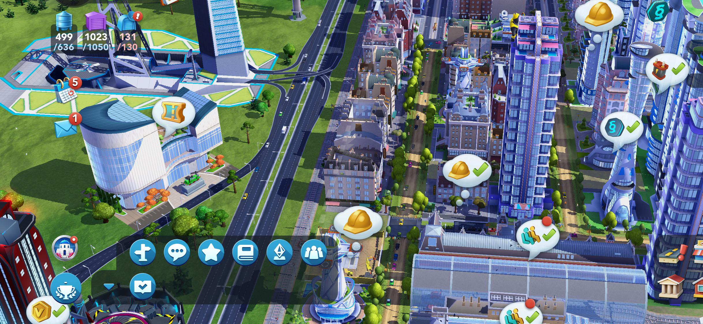
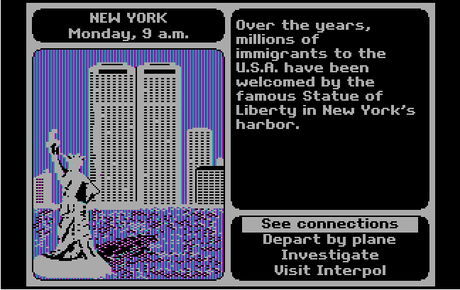
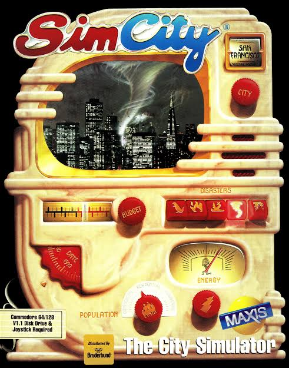
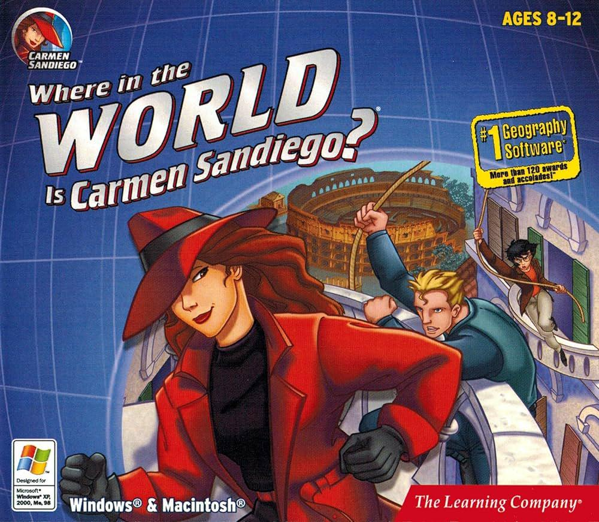

List of good edutainment examples + their target audience, who uses them, where to play, etc. 

<is-land on:visible>

  

    <button @click="active = 'all'" :class="{ on: active === 'all' }" :aria-pressed="active === 'all'">All</button>
    <button @click="active = 'gamecaps'" :class="{ on: active === 'gamecaps' }" :aria-pressed="active === 'gamecaps'">Game Footage</button>
    <button @click="active = 'gamebox'" :class="{ on: active === 'gamebox' }" :aria-pressed="active === 'gamebox'">Game Covers</button>
    <button @click="active = 'gameplat'" :class="{ on: active === 'gameplat' }" :aria-pressed="active === 'type'">Game Platforms</button>
  

  <section class="topic" v-show="active === 'all' || active === 'gamecaps'">
    <h3>Game Footage</h3>
    
    
  </section>
  <section class="topic" v-show="active === 'all' || active === 'photos'">
    <h3>Game Covers</h3>
    
    
  </section>
  <section class="topic" v-show="active === 'all' || active === 'type'">
    <h3>Type</h3>
    
    
  </section>

  <template data-island>
    
  </template>

</is-land>